# Agente de WhatsApp de MermIA: cómo funciona

Este documento explica, con dibujos y diagramas, cómo atiende MermIA a un restaurante por WhatsApp. Está escrito para todo el equipo, sobre todo para producto.

> **Estado (2026-10-30): en construcción.** El bot todavía no existe en el servicio (`apps/api` solo tiene `/health` y la carga de reportes). Cada paso lleva una marca:
> - **[existe]**: hay código o tablas en el repo que lo hacen.
> - **[planeado]**: está diseñado en los documentos o en un ticket, pero no hay código.
>
> Cuando el diseño y el código no coinciden, manda el código. Las diferencias están anotadas.

## En pocas palabras

1. El dueño o el gerente escriben a un número de WhatsApp de MermIA.
2. MermIA reconoce quién escribe por su número y sabe qué puede ver y aprobar.
3. Si es un botón o una pregunta frecuente, contesta el código con una plantilla, sin IA.
4. Lo demás lo atiende un modelo de IA que solo elige qué consulta hacer; las cuentas las hace la base de datos.
5. Antes de enviar, el código revisa que cada número de la respuesta venga de una consulta.
6. Para cambiar un dato, la IA solo propone. Una persona confirma con un botón y el código guarda.
7. Los reportes de Soft Restaurant se guardan, se leen y se cargan; el gerente puede deshacer.

## Fuentes usadas

| Tema | Archivo |
|---|---|
| Diseño del agente, roles y confirmaciones | `docs/kickoff/09-architecture.md` §4 y §5 |
| WhatsApp: archivos, botones, ventana de 24 h | `docs/kickoff/04-whatsapp-platform.md` §5 a §10 |
| Modelos, ruteo, topes y costos | `docs/kickoff/13-llm-and-token-strategy.md` §H4, §I1, §I4 |
| Textos de ejemplo en español | `docs/kickoff/12-sample-agent-messages.md` |
| Petición y respuesta del agente | `packages/contracts/src/mermia_contracts/agent.py` |
| Las 12 herramientas | `packages/contracts/src/mermia_contracts/agent_tools.py` |
| Las 11 consultas y su sobre de respuesta | `packages/contracts/src/mermia_contracts/rpc.py` |
| Cambios pendientes | `packages/contracts/src/mermia_contracts/pending.py` |
| Tablas (`pending_change`, `audit_log`, `llm_usage`, `conversation`, `message_log`) | `supabase/migrations/20261018185214_control.sql` |
| Identidad y consentimiento (`channel_identity`, `consent_log`) | `supabase/migrations/20261018184909_identity_and_sources.sql` |
| Archivos recibidos (`raw_file`) | `supabase/migrations/20261018185012_ingestion.sql` |
| Consultas en SQL (4 de 11) | `supabase/migrations/20261019200000_read_rpcs_first4.sql` |
| Lectura y carga de reportes | `apps/api/src/mermia_api/ingestion/registry.py`, `loader.py`, `errors.py` |
| Prueba de modelos y verificación de números | `apps/eval/src/mermia_eval/config.py`, `tools.py`, `score.py`, `apps/eval/cases/` |
| Decisión de modelo (en curso) | `docs/superpowers/specs/2026-10-30-mr-20-eval-gate-design.md` |
| Tickets | MR-21 (webhook), MR-26 (ruteo), MR-27 (IA y validador), MR-29 (registro), MR-37 (confirmaciones), MR-32 (aplicar cambios) |

## Colores de los diagramas

| Color | Significa | Ejemplo |
|---|---|---|
| Gris | Canal y datos | WhatsApp, tablas, archivos |
| Morado | Lógica fija, escrita en código | ruteo, validaciones, plantillas |
| Coral | Paso donde interviene la IA | elegir herramienta, redactar |
| Verde azulado | Opciones configurables | topes, modelos, quién aprueba |

## Diferencias entre documentos y código

| Tema | Documentos | Código | Qué tomamos |
|---|---|---|---|
| Botones del cambio pendiente | `12` dice Confirmar, Cancelar, Editar | `agent.py` acepta `approve`, `reject`, `detail` (en `09`: Confirmar, Rechazar, Ver detalle) | El código |
| Modelos de IA | `09` y `13` dicen Haiku 5.5 y Sonnet 5.5 | Se comparan 6 modelos en `apps/eval/src/mermia_eval/config.py`; la decisión es MR-20 y aún no existe | Sin decidir |
| Rutas guardadas en `llm_usage` | Haiku / Sonnet | El tipo `app.llm_route` solo acepta `template`, `haiku`, `sonnet`, `fallback` | Puede cambiar tras MR-20 |
| Inicio del prompt igual para todos | `09` §4.2: fecha y sucursales van aparte | El prompt de prueba trae la fecha y las sucursales escritas dentro (`config.py`) | El broker real debe separarlos |
| Mensajes repetidos | `04` §10: no procesar dos veces el mismo mensaje | `message_log` no tiene una regla que impida repetidos | Hueco a cubrir en MR-21 |
| Leer fotos | `12` §4e: se lee la foto con visión | `08` deja fuera del MVP la lectura de fotos | Sin confirmar |

---

## 1. El recorrido de un mensaje

**Pregunta que responde:** ¿qué pasa desde que el dueño escribe una pregunta hasta que recibe la respuesta?

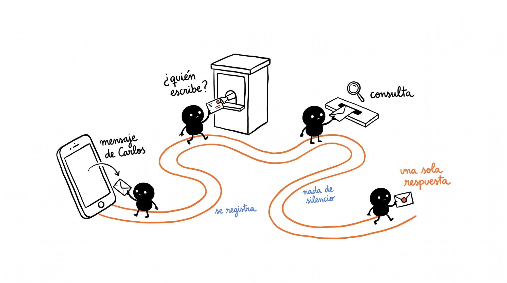

**Ejemplo que seguimos:** Carlos, dueño de la Taquería El Güero (el restaurante de prueba del repo), escribe:

> *"que platillo me deja el menor porcentaje de ganancia este mes"*

Es un caso real del examen de modelos: `apps/eval/cases/top_dishes_least_profitable.json`.

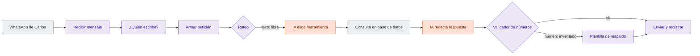

### Paso 1 · Llega el mensaje **[planeado]**
- **Qué pasa:** Meta avisa a nuestro servidor que llegó un mensaje. El servidor contesta "recibido" de inmediato y deja el trabajo en cola.
- **Dónde vive:** el webhook del ticket MR-21, dentro de `apps/api`. Aún no hay archivo.
- **Si falla:** Meta vuelve a intentar el aviso. El diseño pide no procesar dos veces el mismo mensaje (por su id), pero la tabla `message_log` todavía no lo impide.

### Paso 2 · ¿Quién escribe? **[planeado, tablas existen]**
- **Qué pasa:** el número de WhatsApp se busca en `channel_identity`. De ahí salen la persona, su restaurante, su rol (dueño, gerente, admin, soporte) y las sucursales que puede ver.
- **Dónde vive:** tablas `channel_identity`, `membership` y `consent_log` (`supabase/migrations/20261018184909_identity_and_sources.sql`). La lógica es MR-29.
- **Si falla:** un número desconocido, o que no aceptó el aviso de privacidad, no recibe datos.

### Paso 3 · Se arma la petición **[existe el formato]**
- **Qué pasa:** el mensaje se convierte en una `AgentRequest`: restaurante, persona, sucursales, canal, conversación, el texto y hasta cuándo está abierta la ventana de 24 h.
- **Dónde vive:** `packages/contracts/src/mermia_contracts/agent.py`. El mismo formato servirá para el dashboard y el POS.
- **Si falla:** si el formato no es válido, se rechaza antes de llegar a la IA.

### Paso 4 · Ruteo **[planeado]**
- **Qué pasa:** no es un botón ni una pregunta frecuente, así que va a la IA. La sección 2 explica esta decisión.
- **Dónde vive:** MR-26.

### Paso 5 · La IA elige una herramienta **[planeado; probado en el examen]**
- **Qué pasa:** la IA recibe la pregunta y la lista de 12 herramientas. Para este caso debe pedir `get_top_dishes` con `period: this_month`, `metric: margin_pct`, `order: asc`, `limit: 1`.
- **Dónde vive:** las herramientas están en `agent_tools.py`. El ciclo de IA es MR-27.
- **Si falla:** si la IA no pide una herramienta válida dos veces, el diseño escala a un modelo más fuerte (`13` §H4).

### Paso 6 · La base de datos hace la cuenta **[existe para esta consulta]**
- **Qué pasa:** antes de llamar, el código revisa los datos de la petición y llama a la consulta con los permisos de Carlos. Así cada restaurante solo ve lo suyo. La respuesta trae cada número dos veces: el valor crudo y el texto ya formateado (por ejemplo `"$184,320.50"`).
- **Dónde vive:** `api.get_top_dishes` en `supabase/migrations/20261019200000_read_rpcs_first4.sql`. Hoy existen 4 de las 11 consultas; las otras 7 son MR-24. Mientras tanto, las pruebas usan `apps/mock-rpc`, que da una respuesta fija.
- **Si falla:** la respuesta llega con `ok: false` y un código cerrado (`invalid_args`, `not_found`, `no_data`, `forbidden`, `internal`). Para margen sin platillos con costo, la consulta avisa que no hay ventas con costo en ese periodo.

### Paso 7 · La IA redacta y el código revisa los números **[planeado; la regla existe en el examen]**

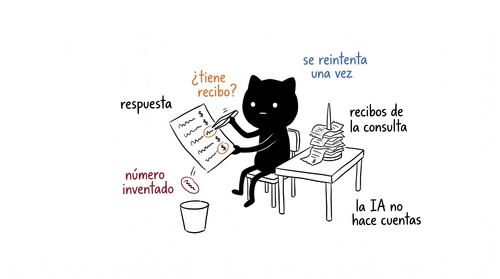

- **Qué pasa:** la IA escribe la respuesta en español de México copiando los textos que dio la consulta. Luego el validador busca cada número de la respuesta en los resultados de las consultas o en la propia pregunta.
- **Dónde vive:** la regla ya existe para el examen en `score_numbers` (`apps/eval/src/mermia_eval/score.py`). El validador en vivo es MR-27.
- **Si falla:** si aparece un número que ninguna consulta dio, se reintenta una vez. Si vuelve a fallar, se manda la versión de plantilla (`13` §I1).

### Paso 8 · Se envía y se registra **[planeado, tablas existen]**
- **Qué pasa:** se envía un solo mensaje. Se guarda una fila en `llm_usage` (modelo, tokens, costo, tiempo, número de herramientas, resultado del validador). La conversación guarda los últimos turnos y un resumen corto en `conversation`.
- **Dónde vive:** `supabase/migrations/20261018185214_control.sql`.
- **Si falla:** Meta reporta que a veces una respuesta dentro de la ventana no se entrega. El plan es reintentar y, si no, usar una plantilla aprobada (`04` §7).

**Por qué es así:** un solo número equivocado rompe la confianza del dueño. Por eso la IA no hace cuentas: la base de datos calcula, la IA copia y el código revisa.

---

## 2. Cómo decide quién contesta

**Pregunta que responde:** ¿cuándo contesta un botón, cuándo una plantilla y cuándo la IA, y con qué modelo?

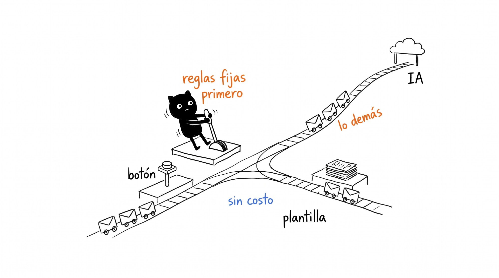

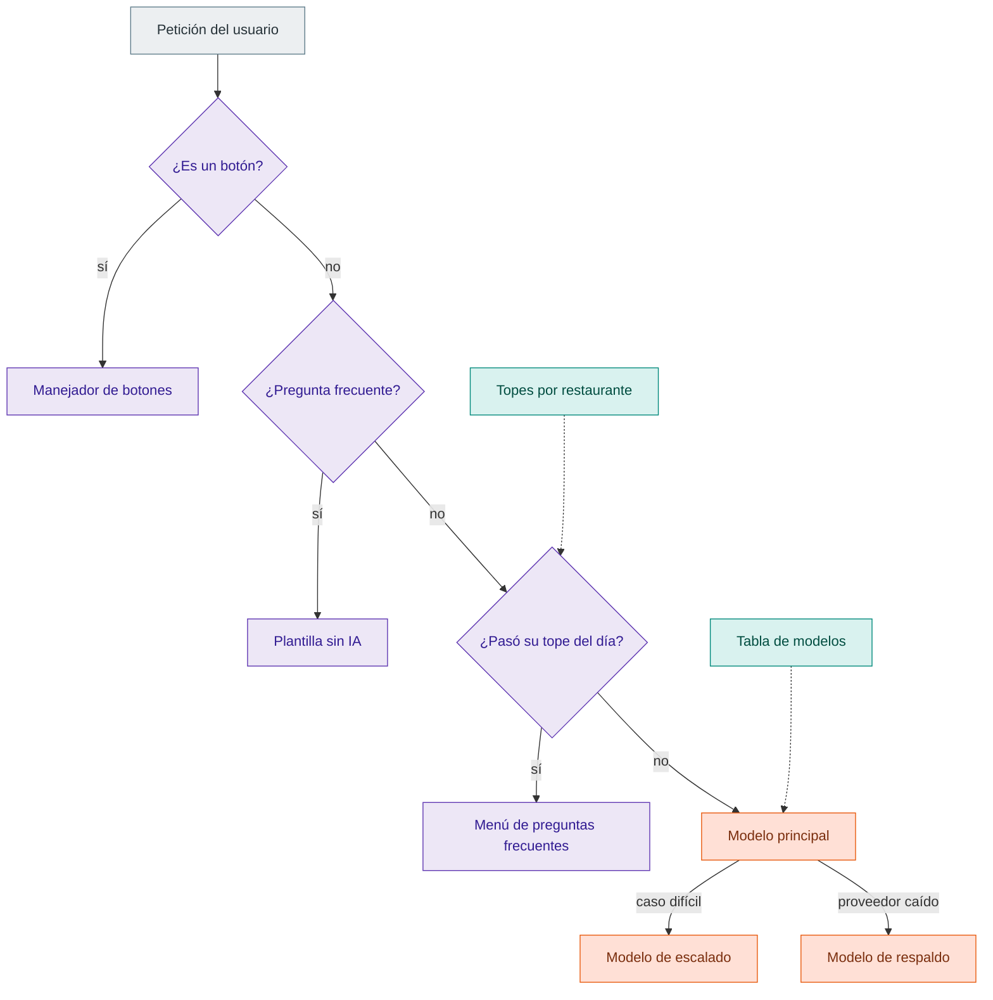

### Paso 1 · ¿Es un botón? **[existe el formato]**
- **Qué pasa:** cada botón trae un id. Si empieza con `pc:` es un cambio pendiente: `pc:<id>:approve`, `pc:<id>:reject` o `pc:<id>:detail`. Esos los atiende el código, sin IA.
- **Dónde vive:** `parse_pending_action` en `agent.py`. Rechaza ids mal formados. Los ids que no empiezan con `pc:` se pasan sin interpretar.
- **Si falla:** un id mal formado da error y no se ejecuta nada.

### Paso 2 · ¿Es una pregunta frecuente? **[planeado]**
- **Qué pasa:** unas 8 preguntas comunes ("¿Cuánto vendimos ayer?") se reconocen con reglas de texto. El código llama a la consulta y llena una plantilla en español. No hay IA, no hay costo de tokens y no hay riesgo de número inventado.
- **Dónde vive:** MR-26. Ejemplo de texto en `12` §2a.
- **Si falla:** si la regla no reconoce la pregunta, pasa a la IA.

### Paso 3 · ¿Se pasó del tope? **[planeado]**

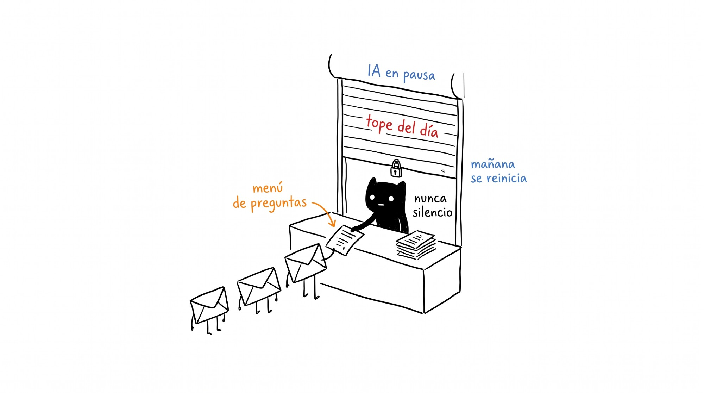

- **Qué pasa:** cada restaurante tiene topes: 60 preguntas a la IA por día, 400 tokens de respuesta, 4 herramientas por pregunta y una pregunta a la vez por chat.
- **Dónde vive:** valores en `09` §4.2 y `13` §I4. Se configuran por restaurante.
- **Si falla:** al pasar el tope, o si la IA o el validador fallan, el usuario recibe el menú de preguntas frecuentes. Nunca silencio.

### Paso 4 · Modelo principal y escalado **[planeado; en evaluación]**
- **Qué pasa:** la mayoría de las preguntas van al modelo principal. Se escala a uno más fuerte si el principal falla dos veces en pedir una herramienta válida, si la pregunta necesita más de 2 herramientas, si es un cambio (`propose_change`) o si el usuario dice que la respuesta está mal.
- **Dónde vive:** reglas en `13` §H4. Qué modelos serán se decide en MR-20 entre 6 candidatos (`apps/eval/src/mermia_eval/config.py`), con un examen de 40 preguntas (`apps/eval/cases/`). Para ser principal un modelo necesita 100 % en números, al menos 95 % en herramienta y en datos, y un costo de US$0.003 o menos por pregunta.
- **Si falla:** si ningún modelo pasa el examen, MR-26 y MR-27 quedan detenidos hasta decidir con el equipo.

### Paso 5 · Modelo de respaldo **[planeado]**
- **Qué pasa:** si el proveedor responde con error de servidor o de límite, se reintenta una vez y luego se usa un modelo de otra empresa.
- **Dónde vive:** `13` §H4.

**Por qué es así:** las reglas fijas son baratas, rápidas y no se equivocan con los números. La IA queda para lo que de verdad necesita lenguaje. El diseño espera que entre 30 % y 45 % de las preguntas se contesten sin IA (estimación sin medir, `13` §I1).

---

## 3. Cómo se cambia un dato (aquí interviene una persona)

**Pregunta que responde:** ¿qué pasa cuando el dueño pide cambiar un precio?

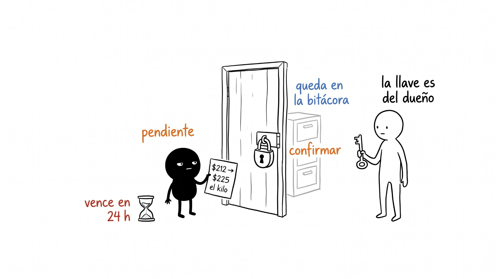

**Ejemplo que seguimos** (de `12` §3): Carlos escribe *"oye ya me subieron el bistec, ahora me lo dan a 225 el kilo"*. El precio actual es $212.00 el kilo.

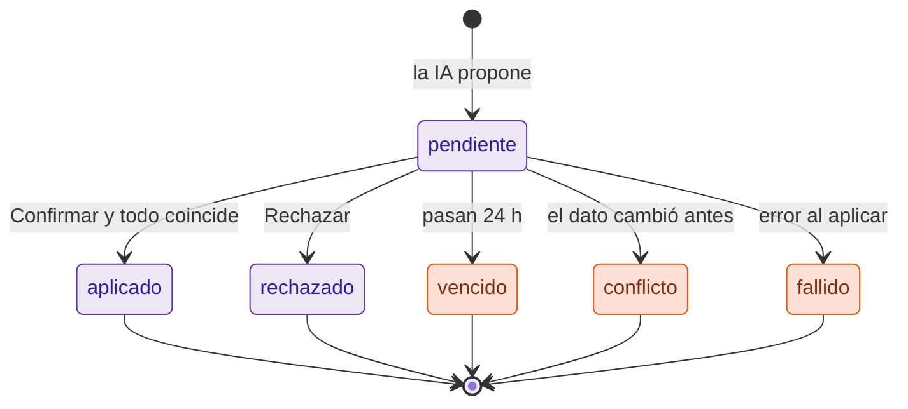

> En este diagrama el coral marca los finales que requieren aviso, no un paso de IA. Los estados salen del tipo `app.pending_change_status`, que también tiene `approved` (aprobado antes de aplicar).

### Paso 1 · La IA propone, no guarda **[planeado; probado en el examen]**

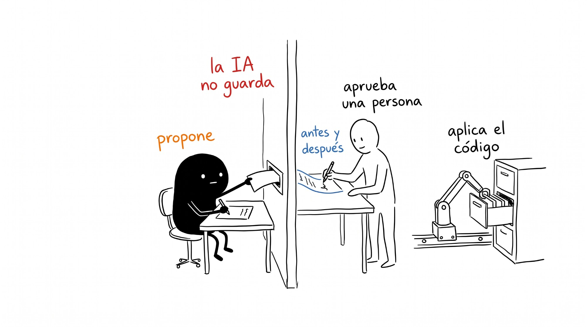

- **Qué pasa:** la IA llama a `propose_change` con el tipo `ingredient_price.set`, el ingrediente por nombre y el precio como lo dijo el usuario (225 por kg). La IA no convierte unidades.
- **Dónde vive:** `ProposeChangeArgs` en `agent_tools.py`. Hay 5 tipos de cambio en `pending.py`: precio de ingrediente, receta, precio de platillo, aprobar lote y deshacer lote. En el examen, `propose_change` no escribe nada (`apps/eval/src/mermia_eval/tools.py`).
- **Si falla:** si los valores no corresponden al tipo de cambio, el formato se rechaza.

### Paso 2 · Se guarda como pendiente **[planeado, tabla existe]**
- **Qué pasa:** el servicio de confirmación convierte el precio a pesos por unidad base, busca el ingrediente, lee la versión actual y calcula qué platillos cambian. Guarda una fila en `pending_change` (estado `pending`, vence en 24 h) y otra en `audit_log`.
- **Dónde vive:** MR-37. Tablas en `supabase/migrations/20261018185214_control.sql`. `audit_log` no se puede editar ni borrar.
- **Si falla:** no se envía nada al dueño y no cambia ningún dato.

### Paso 3 · El dueño recibe el cambio con botones **[planeado]**

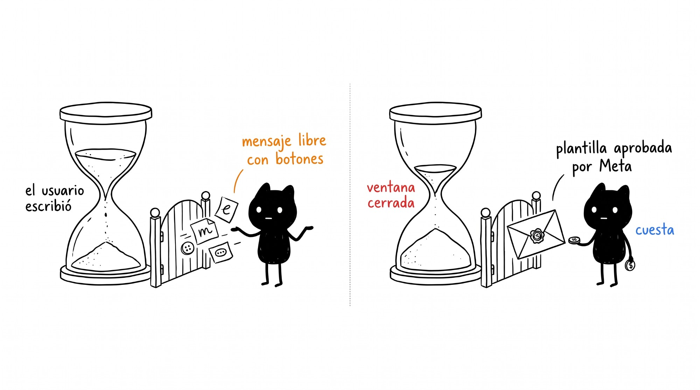

- **Qué pasa:** llega un mensaje con lo de antes y lo de después, los platillos afectados y tres botones: Confirmar, Rechazar, Ver detalle.
- **Ventana de 24 h:** si Carlos escribió en las últimas 24 h, se puede mandar un mensaje libre con botones. Si no (por ejemplo, cuando un gerente propone y el dueño aprueba), solo se puede usar la plantilla aprobada por Meta `cambio_pendiente`, que cuesta (`04` §7).
- **Dónde vive:** MR-37. El texto de ejemplo está en `12` §3a.
- **Si falla:** si la plantilla no está aprobada por Meta (MR-4), no hay forma de avisar fuera de la ventana.

### Paso 4 · Carlos toca Confirmar **[planeado; el formato existe]**
- **Qué pasa:** el botón trae `pc:<id>:approve`. No se le cree tal cual: el código vuelve a revisar en la base de datos que el cambio sea del mismo restaurante, que Carlos tenga un rol que pueda aprobar, que siga pendiente, que no haya vencido y que el dato no haya cambiado desde la propuesta.
- **Dónde vive:** `apply_pending_change(id, user_id)`. Solo lo puede ejecutar el backend (`pending.py`). La función SQL es MR-32.
- **Si falla:** si el dato cambió, queda en `conflicto`. Si ya se resolvió, contesta "ya estaba aplicado". Si venció, lo dice y se puede volver a proponer.

### Paso 5 · Se aplica y se avisa **[planeado]**
- **Qué pasa:** en una sola operación se guarda el precio nuevo, el cambio queda `aplicado` y `audit_log` guarda el antes y el después. Luego se recalculan los costos de los platillos y se avisa a Carlos.
- **Dónde vive:** MR-32 y MR-37. El cálculo de costos existe desde MR-25 (`supabase/migrations/20261022090000_costing_engine.sql`). No verifiqué cómo se dispara después de un cambio.

**Quién puede aprobar** (valores por defecto, configurables por restaurante, `09` §5.1):

| Cambio | Aprueban |
|---|---|
| Precio de ingrediente, receta | dueño, gerente, admin |
| Precio de platillo | dueño, admin |
| Aprobar o deshacer un lote de reporte | dueño, gerente |

**Por qué es así:** una IA puede entender mal "225". Si guardara directo, un error cambiaría los márgenes de todo el menú sin que nadie lo viera. Con la confirmación, la persona ve el antes y el después y queda registrado quién aprobó.

---

## 4. Cómo llega un reporte de Soft Restaurant

**Pregunta que responde:** ¿qué pasa cuando el gerente manda el Excel del día?

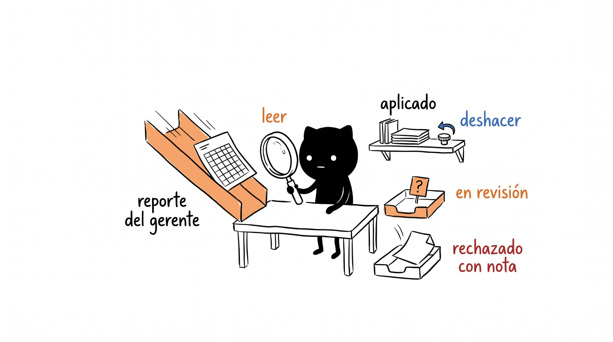

**Ejemplo:** Laura, gerente de la sucursal Centro, manda el reporte "Productos vendidos" del día anterior.

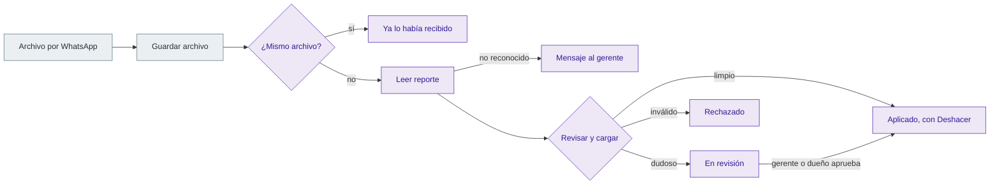

No hay IA en este recorrido.

### Paso 1 · Se descarga y guarda el archivo **[planeado; la tabla existe]**

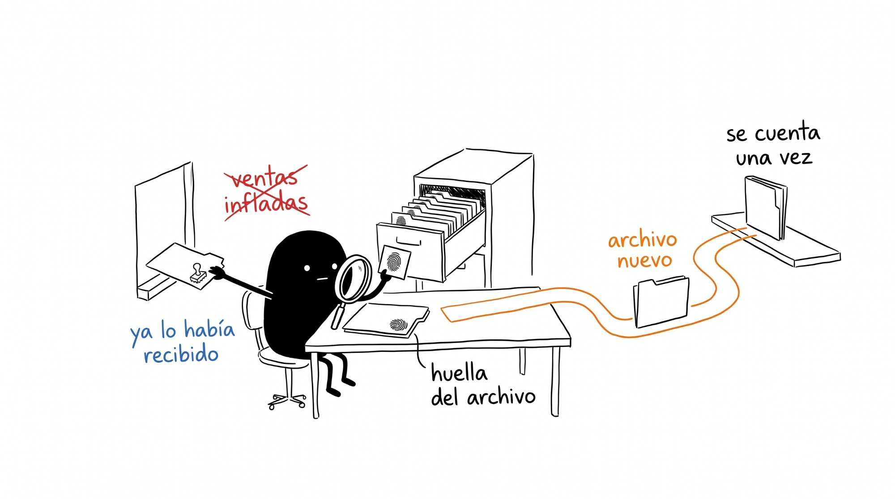

- **Qué pasa:** el enlace de descarga de Meta dura 5 minutos, así que el archivo se descarga al llegar. Se guarda con su huella digital (sha256) en `raw_file`.
- **Dónde vive:** MR-21. La tabla `raw_file` no permite dos archivos con la misma huella en el mismo restaurante (`supabase/migrations/20261018185012_ingestion.sql`).
- **Si falla:** si se vence el enlace, se pide uno nuevo con el id del archivo, que dura 7 días (`04` §5).

### Paso 2 · Se lee el reporte **[existe]**
- **Qué pasa:** el código busca qué tipo de reporte es. Hoy solo lee "Productos vendidos" en `.xlsx`.
- **Dónde vive:** `parse_file` en `apps/api/src/mermia_api/ingestion/registry.py`. Los errores están en `errors.py`.
- **Si falla:** nunca truena. Devuelve un mensaje en español para el gerente, por ejemplo *"No reconocí este reporte. Por ahora puedo leer: «Productos vendidos» de Soft Restaurant."*

### Paso 3 · Se revisa y se carga **[existe]**
- **Qué pasa:** todo ocurre en una sola operación:
  - **Duplicado:** si es el mismo archivo, o el mismo contenido para la misma sucursal y día, devuelve el lote anterior y no escribe nada.
  - **Rechazado:** totales que no cuadran, filas fuera del periodo, sin sucursal.
  - **En revisión:** corrige un día ya cargado, es de otro día que el esperado o nombra otra sucursal.
  - **Aplicado:** si está limpio, se aplica en ese momento.
- **Dónde vive:** `load` en `apps/api/src/mermia_api/ingestion/loader.py`.
- **Si falla:** si algo falla a la mitad, no se guarda nada (todo o nada).

### Paso 4 · Una persona aprueba lo dudoso **[existe la función]**
- **Qué pasa:** un lote en revisión solo se aplica si un gerente o el dueño lo aprueba. La base de datos revisa quién puede.
- **Dónde vive:** `approve` en `loader.py`, que llama a `app.apply_batch`. Los mensajes al gerente son MR-28.

### Paso 5 · Deshacer **[existe la función]**
- **Qué pasa:** con "Deshacer", el lote deja de contar y el anterior vuelve a contar.
- **Dónde vive:** `rollback` en `loader.py`, que llama a `app.rollback_batch`.

**Por qué es así:** los gerentes reenvían archivos. Sin la huella y la revisión, un mismo día se contaría dos veces y las ventas saldrían infladas.

---

## Lo que no aparece en los diagramas

**Tareas periódicas (todas planeadas):**
- **Reporte semanal** los lunes por la mañana con la plantilla `reporte_semanal`, armado por código, sin IA (MR-38, `12` §1).
- **Recordatorio al gerente** si no llega el reporte (`recordatorio_reporte`) y **aviso al dueño** tras 2 días sin reporte (`reporte_faltante`), `12` §4h y §4i.
- **Vencimiento de cambios** pendientes a las 24 h, con aviso (`12` §3e). No está definido qué proceso lo dispara.
- **Resumen de la conversación** cada 8 a 10 turnos para que la memoria sea corta (`13` §I1).
- **Alertas internas:** costo de IA de un restaurante 3 veces arriba de su promedio, validador rechazando más de 2 %, proveedor fallando más de 2 % (`13` §I4).

**Modos especiales:**
- **Fuera de tema:** respuesta fija en español. Ayuda a cumplir la política de Meta para bots de IA (`09` §4.2, `04` §8).
- **Privacidad:** la IA nunca ve teléfonos, RFC ni nombres completos del personal; solo nombres de pila e ids (`09` §4.2).
- **Correo:** Corte Z y facturas CFDI también podrán llegar por correo (MR-39).
- **Reportes de prueba de modelos:** el examen manda trazas a Langfuse. Solo debe usarse con el mock, nunca con datos reales (`apps/eval/README.md`).

**Estado actual en producción:**
- **Nada está desplegado.** El despliegue en Render, Sentry y la medición de costos son MR-40.
- El número de WhatsApp (MR-3), la verificación de Meta (MR-2) y las plantillas (MR-4) siguen abiertos.
- No hay restaurante piloto ni reportes reales todavía (MR-5). El formato de "Productos vendidos" que leemos es provisional.

**No verificado al escribir este documento:**
- Cómo se dispara el recálculo de costos después de aplicar un cambio o un lote.
- Cómo se manejarán los mensajes repetidos de Meta (no hay regla en `message_log`).
- Qué modelos ganarán en MR-20.
- Ningún paso marcado **[planeado]** se ha probado con WhatsApp real.
