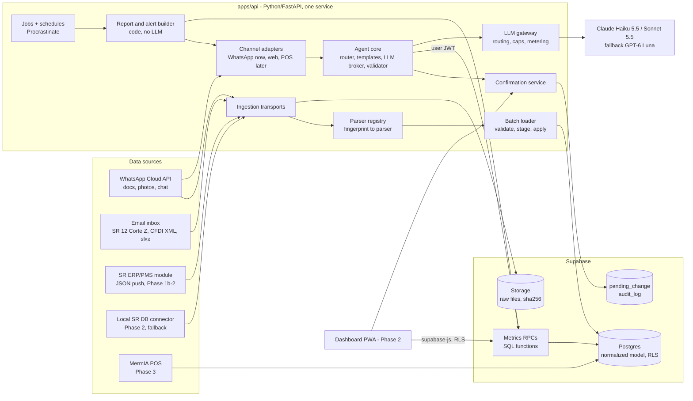
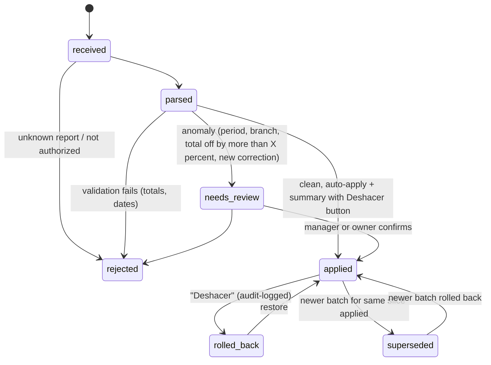
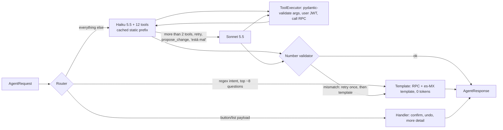
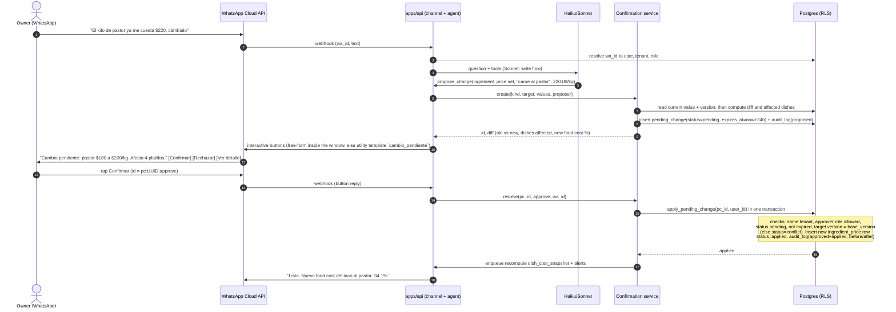

# 09 - Architecture

Date: 2026-10-15. Labels: **verified**, **likely** and **unverified** apply to facts and point to the research files (01, 03, 04, 13, `research/pos-legal-stack-notes.md`, called "notes" below). Design choices are **opinion**, marked as decisions (D1, D2, ...).

## Key decisions

| # | Decision | Why |
|---|---|---|
| D1 | **One normalized, POS-agnostic Postgres model.** Every fact row carries `tenant_id`, `location_id`, `source_id`, `external_id` and `batch_id`. | SR is source #1 of several. Our own POS writes to the same tables in Phase 3. |
| D2 | **Split adapters into transports and parsers.** WhatsApp, email and HTTP push are transports. SR xlsx, Corte Z, CFDI XML, ERP/PMS JSON and photo OCR are parsers. Every parser emits one `NormalizedBatch`. | The same SR file can arrive by WhatsApp or by email, so each parser is written once. |
| D3 | **Facts are insert-only and batch-scoped.** A batch is `applied`, `superseded` or `rolled_back`, and metric views read only the current batch of each slice. | Rollback and correction then mean flipping a status, never deleting rows. This meets the "reviewable and reversible" rule. |
| D4 | **Two fact grains: ticket and aggregate.** | SR exports are mostly aggregated ("Productos vendidos", Corte Z). The ERP/PMS push, the connector and our POS are ticket-level. Metrics read one unified daily view. |
| D5 | **The metrics layer is Postgres SQL functions (RPCs).** They return small, pre-formatted JSON and are called through PostgREST under RLS. | The agent, dashboard and POS share one implementation. Numbers are computed once, in SQL. |
| D6 | **The agent is a deterministic router first and an LLM second.** Templates answer the top questions with zero tokens. Claude Haiku 5.5 brokers 12 tools, and a validator rejects any number not found in the tool output. | Token cost (13: about US$0.66 per restaurant per month) and owner trust. |
| D7 | **Writes happen only through `pending_change`.** The agent's only write tool is `propose_change`. The change is applied by an `apply_pending_change()` SQL function after a role-checked human approval. Every step is logged in an append-only `audit_log`. | This is the human-approval rule from the brief, and it is channel-agnostic. |
| D8 | **Tool calls run as the user.** The backend mints a short-lived JWT holding the user's `tenant_id`, role and locations, so RLS applies to agent reads too. The service role is used only by ingestion and the apply functions. | A prompt-injection or tool-argument bug cannot cross tenants. |
| D9 | **Python backend, TypeScript frontend**, with **Supabase** (Postgres, RLS, Auth, Storage) and **one always-on FastAPI service**. Pydantic is the source of truth for contracts; TypeScript types for the dashboard and POS are generated from its JSON Schema. | Python is stronger for messy Excel parsing and LLM work. The generated types keep one schema across all three phases (**opinion**; the generation pipeline is untested, allow half a day in Phase 2). |

## 1. Components



Module boundaries (these follow the Dev A / Dev B split in `08-mvp-4-week-plan.md`):

| Module | Owns | Talks to others only through |
|---|---|---|
| `packages/contracts` | Pydantic models (plus exported JSON Schema): `NormalizedBatch`, RPC request and response types, agent tool JSON schemas, `PendingChange` kinds, `AgentRequest`/`AgentResponse`, fixtures | Imported by everything; changes need both devs to approve |
| `packages/db` | Migrations, RLS policies, metric RPCs, `apply_batch`, `rollback_batch`, `apply_pending_change`, pgTAP tests | SQL function signatures in contracts |
| `apps/api/ingestion` | Transports, parser registry, batch loader | `NormalizedBatch`, `apply_batch` |
| `apps/api/agent` | Router, templates, LLM broker, validator, memory | Tool schemas; RPCs reached through `ToolExecutor` |
| `apps/api/channels` | WhatsApp webhook, sending, media download, template registry | `AgentRequest`/`AgentResponse` |
| `apps/api/confirm` | Creating, notifying, resolving and expiring pending changes | `PendingChange` contract, `apply_pending_change` |
| `apps/evals` | 40-question eval, mock tool backend | Tool schemas and fixtures |

## 2. Normalized data model

Columns shared by every table:
- `id uuid` (UUIDv7, can be generated on a device for Phase 3), `tenant_id`, `created_at`, `updated_at`, `version int` (optimistic concurrency).
- Fact and catalog rows also carry `location_id`, `source_id`, `external_id` and `batch_id`.
- Money is `bigint` centavos plus `currency char(3)`, with gross and net (IVA) stored separately.
- Each location has a time zone, and every fact carries a `business_date`.

### 2.1 Tenancy, identity, sources

| Entity | Key fields | Notes |
|---|---|---|
| `tenant` | name, rfc, plan, settings (food-cost target, report cadence), status | One per restaurant business; a chain is one tenant |
| `location` | tenant_id, name, timezone, address, sr_version, sr_edition | Multi-location from day 1 |
| `app_user` | name, phone_e164, email, auth_user_id | One person can belong to several tenants |
| `membership` | user_id, tenant_id, role (`owner`, `manager`, `admin`, `support`), location_ids[] (null = all), can_approve[] | Tenant roles. `support` is MermIA staff and can propose but never approve |
| `channel_identity` | user_id, channel (`whatsapp`, `web`, `pos`), external_id (wa_id), verified_at | Maps a sender to a user. Unknown senders are ignored |
| `consent_log` | user_id, notice_version, channel, accepted_at, message_types | Opt-in and aviso de privacidad evidence (04, notes 2.2) |
| `source` | tenant_id, location_id, kind (`sr_report`, `sr_corte_email`, `sr_erp_push`, `sr_connector`, `cfdi`, `photo_ocr`, `manual`, `mermia_pos`), config, api_key_hash, status | One row per configured data source |
| `external_ref` | source_id, entity_type, external_id, internal_id | Maps SR product codes (`IdProducto`), CFDI UUIDs and so on to internal IDs |

### 2.2 Ingestion

| Entity | Key fields | Notes |
|---|---|---|
| `raw_file` | storage_path, sha256, mime, filename, size, received_via, sender_user_id, received_at, retention_until | Original file is kept for audit and re-parsing (90-day default, an opinion) |
| `import_batch` | source_id, raw_file_id, parser (`sr.productos_vendidos@v1`, ...), slice_key (location, business_date range, grain), status, stats (rows, totals, anomalies), supersedes_batch_id, quality (`file`, `push`, `ocr`), applied_by, applied_at, rolled_back_by, rolled_back_at | State machine in 2.6 |
| `import_issue` | batch_id, severity, code, message_es, row_ref | Shown to the manager in Spanish |

### 2.3 Catalog and sales facts

| Entity | Key fields | Notes |
|---|---|---|
| `menu_category` | name, parent_id | From the SR product group |
| `menu_item` | name, normalized_name, category_id, kind (`dish`, `drink`, `modifier`, `combo`), is_active | Shared across locations. A location-level override is possible later |
| `menu_item_price` | menu_item_id, location_id, price_gross, tax_rate, effective_from, effective_to, source | Effective-dated, so past margins can be recomputed |
| `modifier_link` | menu_item_id, modifier_item_id, price_delta | Modifiers are `menu_item`s of kind `modifier` |
| `staff` | display_name (first name only), external_id, role | Personal data; keep it minimal (notes 2.3) |
| `sale_ticket` | business_date, opened_at, closed_at, channel (`dine_in`, `takeout`, `delivery_app`, `delivery`), area, table, guests, staff_id, subtotal, discount, tax, tip, total, status (`paid`, `cancelled`), fiscal_status (`none`, `requested`, `in_global`, `stamped`) | Ticket grain: ERP push, connector, POS |
| `sale_line` | ticket_id, menu_item_id, parent_line_id (modifier), qty (numeric), unit_price, discount, tax, net, is_void, void_reason, voided_by | |
| `payment` | ticket_id, method (`cash`, `card`, `transfer`, `voucher`, `other`), amount, tip, provider, provider_ref | |
| `item_sales_agg` | location_id, business_date (or period), menu_item_id, units, gross, discount, net | Aggregate grain: "Productos vendidos" style reports |
| `daily_sales_agg` | location_id, business_date, net_sales, tax, tickets, guests, discounts, cancellations, payment_mix jsonb, tips | Aggregate grain: Corte Z / "Ventas por día" |

### 2.4 Costing

| Entity | Key fields | Notes |
|---|---|---|
| `supplier` | name, rfc (null for informal suppliers), kind (`cfdi`, `market`, `other`) | |
| `ingredient` | name, base_unit (`g`, `ml`, `pza`), category, default_yield_pct, yield_source (`default`, `measured`) | |
| `ingredient_alias` | supplier_id, source_text, ingredient_id, pack_qty, pack_unit, confirmed_by | Learned mapping from CFDI or nota text (03 C.3) |
| `unit_conversion` | ingredient_id (null = global), from_unit, to_unit, factor | kg to g, caja 12 pza, density only when needed |
| `purchase_doc` | supplier_id, kind (`cfdi`, `nota_photo`, `manual`), cfdi_uuid (unique), issued_at, subtotal, total, raw_file_id | |
| `purchase_line` | purchase_doc_id, description, qty, unit, unit_price_net, ingredient_id (nullable until mapped) | |
| `ingredient_price` | ingredient_id, unit_price_net per base unit, effective_from, effective_to, source (`cfdi`, `nota`, `sr_import`, `manual`, `benchmark`), source_ref, confidence, batch_id or pending_change_id | Append-only. Cost of record per date follows source priority (03) |
| `recipe` | menu_item_id or produces_ingredient_id (sub-recipe), version, effective_from, effective_to, yield_qty, status (`draft`, `confirmed`) | |
| `recipe_line` | recipe_id, ingredient_id or sub_recipe_id, qty_base, yield_override_pct | |

### 2.5 Control, metrics, operations

| Entity | Key fields | Notes |
|---|---|---|
| `pending_change` | kind, target_type, target_id, base_version, payload (new values), diff (before/after for display), proposed_by_user, proposed_via (`agent`, `dashboard`, `import`, `pos`), required_role, status (`pending`, `approved`, `rejected`, `expired`, `conflict`, `applied`, `failed`), expires_at, resolved_by, resolved_at, resolved_via | Section 5 |
| `audit_log` | ts, actor_user_id, actor_kind (`user`, `system`, `agent`), channel, action, entity_type, entity_id, before, after, pending_change_id, batch_id, request_id | Append-only: a trigger blocks UPDATE and DELETE, and there are no grants for either |
| `dish_cost_snapshot` | menu_item_id, location_id, date, cost, price_net, food_cost_pct, margin, confidence (`confirmed`, `estimated`, `missing`) | Recomputed when a price, recipe or batch changes |
| `daily_location_metrics` | location_id, business_date, net_sales, tickets, avg_ticket, theoretical_food_cost_pct, cost_coverage_pct | Precomputed, so RPCs stay fast |
| `alert` / `price_suggestion` | rule, subject, value, threshold, status, suggested_price, rationale_code | Rules live in code (03) |
| `report_run` | kind (`weekly`, `daily`), period, recipients, template, status, wa_message_ids | |
| `conversation` | user_id, channel, summary (≤300 tokens), last_turns jsonb, window_open_until | Short memory (13 I1) |
| `llm_usage` | the fields in 13 I4 | Cost metering from day 1 |
| `message_log` | wa_message_id, direction, template, pricing_category, billable, cost_usd | Reconciled against the Meta invoice (04, item 10.7) |

### 2.6 Import batch lifecycle (reviewable, reversible)



Rules:
- `slice_key = (location_id, business_date range, grain, report_type)`. Applying a batch supersedes the current batch for that slice. Rolling it back makes the superseded batch current again.
- Same sha256 as an earlier file: ignore it and reply that the file was already received. Same slice with a different hash: treat it as a correction and send it to `needs_review`.
- Metric views join `import_batch` and keep only `status = 'applied'`. Rows are never deleted.
- **Catalog changes from imports** (new recipe costs from the SR "Recetas" report, new prices) do not auto-apply. The batch produces one `pending_change` change set (03 C.1). New menu items seen in sales do auto-create, because they are reversible with the batch.
- Unified grain: `v_item_sales_daily` uses ticket-grain data for a (location, date) when it exists and aggregate data otherwise. `v_daily_sales` works the same way. Totals from both grains are cross-checked when both exist; this is the shadow-mode reconciliation for the ERP push and the connector.

## 3. Adapters

| Adapter | Transport | Parser output | Grain | Phase | Status of the source facts |
|---|---|---|---|---|---|
| SR report parser (xlsx/xls: "Productos vendidos", "Ventas por día", "Cuentas desglose", "Recetas") | WhatsApp document, email attachment | `NormalizedBatch` | aggregate (ticket grain for "Cuentas desglose") | 1 | Report names **verified** for SR 8. Columns for SR 10-12 **unverified**; get pilot samples (01) |
| SR Corte Z email | Email inbox (SR 12 SMTP) | `NormalizedBatch` (daily_sales_agg) | daily aggregate | 1 (if the pilot runs SR 12) | Feature **verified**; format **unverified** (01) |
| CFDI 4.0 XML | Email (preferred), WhatsApp document | `NormalizedBatch` (purchase_doc, purchase_line, price observations) | purchase line | 1 (week 3 stretch) / 1b | Spec fields **likely**. Delivery of XML over WhatsApp is **unverified** (04) |
| Photo / nota OCR | WhatsApp image | Draft `NormalizedBatch` with `quality=ocr`, always `needs_review` | as read | 1b | **likely** feasible |
| SR ERP/PMS push | HTTPS endpoint `POST /ingest/sr-erp/{source_id}`, `x-api-key` | `NormalizedBatch` (tickets, lines, payments, tips) | ticket | 1b-2 | Payload and triggers **verified**; module price **unverified** (01) |
| Local SR DB connector | Windows service, outbound HTTPS | `NormalizedBatch` (tickets, recipes, inventory) | ticket + catalog | 2 (only where the ERP push is not possible, or for recipes) | Feasible, with commercial precedent; schema **unverified**; legal risk medium (01, 03) |
| MermIA POS | Direct writes (sync engine) | Same tables; `source.kind = mermia_pos`; one batch per location and business_date | ticket/event | 3 | Design |

Parser contract (in `packages/contracts`, sketch):

```ts
type NormalizedBatch = {
  contractVersion: 1;
  parser: string;                    // "sr.productos_vendidos@v1"
  sourceKind: SourceKind;
  locationHint?: string;             // branch name read from the file
  period: { from: string; to: string };  // ISO dates, business dates
  grain: "ticket" | "item_daily" | "daily" | "purchase" | "catalog";
  totals: { netSales?: Cents; units?: number; lines: number };  // for validation
  menuItems?: MenuItemIn[];          // externalId?, name, category?, price?
  itemSales?: ItemSalesIn[];
  dailySales?: DailySalesIn[];
  tickets?: TicketIn[];              // with lines[], payments[]
  purchases?: PurchaseIn[];
  recipes?: RecipeIn[];              // become a pending_change, never applied directly
  issues: IssueIn[];                 // severity, code, message_es
};
```

Parsers are pure functions (`(bytes, meta) => NormalizedBatch`), tested with golden files: pilot export in, expected JSON out. The parser registry picks a parser by fingerprint (sheet names, header row, XML namespace).

## 4. Shared metrics layer and agent

### 4.1 Metric RPCs (v1)

- All of these are `SECURITY INVOKER` SQL functions, so RLS applies.
- `period` is an enum: `today`, `yesterday`, `this_week`, `last_week`, `prev_week`, `this_month`, `last_month`, `last_7d`, `last_30d`, or `{from, to}`. `location_id` null means every location the user can see.
- Responses use one envelope: `{ ok, data, flags[], meta: { as_of, coverage_pct, period_resolved } }`. Numbers come pre-formatted (`"$184,320.50"`, `"+7.2%"`), plus a raw value for charts. Each result stays under about 400 tokens.
- Names match the eval in 13 H3.

| # | RPC / agent tool | Returns (data) |
|---|---|---|
| 1 | `get_sales_summary(period, location_id?)` | net sales, tickets, avg ticket, guests, discounts, cancellations, change vs previous equivalent period |
| 2 | `compare_periods(metric, period_a, period_b, location_id?)` | both values, abs and % change; metric ∈ `net_sales, tickets, avg_ticket, guests, food_cost_pct, units` |
| 3 | `compare_locations(metric, period, location_ids?)` | value per location, rank, difference vs best |
| 4 | `get_top_dishes(period, metric, order='desc', limit=5, location_id?, category?)` | top N items; metric ∈ `units, revenue, margin, margin_pct`; limit ≤ 10 |
| 5 | `get_sales_breakdown(period, by, location_id?)` | rows by `payment_method, staff, hour, weekday, channel, category` |
| 6 | `get_cancellations(period, kind='cancellations', location_id?)` | count, amount, top items, by staff (first names); kind ∈ `cancellations, discounts` |
| 7 | `get_dish_margin(dish, location_id?)` | cost, net price, margin, food cost %, confidence, top 3 cost drivers; `dish` is an id or a fuzzy name (returns candidates when ambiguous) |
| 8 | `get_food_cost_pct(period, location_id?, group_by='none')` | theoretical food cost %, target, coverage % of sales with a costed recipe, by category |
| 9 | `get_menu_engineering(period, location_id?)` | Kasavana-Smith quadrant counts plus the top items in each (03) |
| 10 | `get_cost_alerts(since='last_7d', location_id?)` | ingredient price moves, dishes breaching target, open price suggestions (the suggestion is computed in code) |
| 11 | `get_data_status(location_id?)` | last batch per source, missing business days, stale costs, coverage |
| 12 | `propose_change(kind, target, values, reason?)` | the only write tool; creates a `pending_change` and returns its id and diff (section 5) |

The dashboard calls 1-11 directly. The weekly report job calls 1, 4, 8, 10 and 11. The POS (Phase 3) uses the same functions over its own data.

### 4.2 Agent pipeline (lean broker)



- Static prefix (system prompt plus tool definitions, about 2,700 tokens) is byte-identical for all tenants. Tenant, date, role and location list go in a tail message (13 I1).
- Memory is the last 3-4 turns plus a ≤300-token summary. Old tool results are never replayed.
- Caps per tenant: 60 LLM questions a day, `max_tokens` 400, 4 tool calls, 1 request in flight. Over a cap, the user gets the template menu.
- The LLM never sees phone numbers, RFCs or full staff names. Tools return first names and IDs only.
- Scope guard: off-topic requests get a fixed Spanish reply, which helps with Meta's AI policy (04 section 8).

### 4.3 Channel-agnostic interface

```ts
type AgentRequest = {
  tenantId: string; userId: string; locationIds: string[];
  channel: "whatsapp" | "web" | "pos";
  conversationId: string;
  input: { type: "text"; text: string }
       | { type: "action"; actionId: string }   // button or list tap, e.g. "pc:<uuid>:approve"
       | { type: "media"; rawFileId: string };
  windowOpenUntil?: string;                     // WhatsApp only; null elsewhere
};
type AgentResponse = {
  messages: Array<
    | { kind: "text"; text: string }
    | { kind: "choices"; text: string; options: { id: string; label: string }[] } // ≤3 -> buttons, else list
    | { kind: "metric_card"; rpc: string; data: unknown }                          // web/POS render; WhatsApp flattens to text
  >;
  route: "handler" | "template" | "haiku" | "sonnet" | "fallback";
  usageId?: string;
};
```

The WhatsApp adapter turns `choices` into reply buttons (≤3, 20-character labels) or a list message (04 section 6). Outside the 24-hour window it uses an approved utility template. The web and POS adapters render the same objects as components.

## 5. Write-confirmation flow

### 5.1 Roles (defaults, configurable per tenant)

| Change kind | Can propose | Can approve |
|---|---|---|
| `ingredient_price.set`, `ingredient_alias.confirm` | owner, manager, admin, support, agent | owner, manager, admin |
| `recipe.upsert` (lines, yields) | same | owner, manager, admin |
| `menu_item_price.set` (records the price; the owner changes it in SR in Phase 1) | same | owner, admin |
| `import_batch.approve` (needs_review), `import_batch.rollback` | manager, owner | owner, manager |
| `settings.update` (food-cost target, report cadence, users and roles) | owner, admin | owner |
| Phase 3: void, discount or refund above threshold, cash correction | cashier, waiter | manager, owner (PIN on the POS) |

### 5.2 Sequence (WhatsApp, Phase 1)



Rules:
- The button payload is never trusted on its own; it is always re-checked against the database (04 section 6).
- The apply is idempotent: a second tap gets "ya estaba aplicado".
- Taps on stale buttons get a clear message (expired, already resolved, or changed since the proposal).
- Default expiry is **24 hours**, which matches the free-form window. An expired change can be re-proposed in one tap.
- If the approver is not the proposer (for example, a manager proposes a price change), the approver gets a utility template. The proposer is told the result.
- The LLM never calls `apply_*`. Only the confirmation service does, and only on a human action.

### 5.3 Later channels

| Channel | Same pieces | Differences |
|---|---|---|
| Dashboard (Phase 2) | `pending_change` list and diff view; Approve and Reject call the same `apply_pending_change` RPC under the user's session | Bulk approve for import change sets; filter by location; full audit view |
| POS (Phase 3) | Same table and function | Manager PIN or card on the device as the approval step. Offline approvals queue as signed events and are applied server-side in order; a conflict follows the same `base_version` rule |

## 6. Multi-tenancy

- Every table has `tenant_id NOT NULL`, indexed first in composite indexes.
- RLS policy on every table: `tenant_id = (select auth.jwt()->>'tenant_id')::uuid`. Wrapping the call in a subselect is Supabase's documented performance pattern (**likely**). There is an additional location filter from `membership.location_ids`.
- The dashboard uses Supabase Auth sessions with `tenant_id` set as a custom claim through an auth hook (**likely** available on Pro; verify in week 1).
- Agent and job calls use a short-lived JWT minted by the API for the resolved user (D8). Only ingestion (`apply_batch`) and `apply_pending_change` run as `SECURITY DEFINER` with explicit tenant checks inside.
- Tests: pgTAP suite with two fixture tenants. Every RPC is called as tenant A and must return nothing for tenant B. It runs in CI on every migration.
- Supabase's service role bypasses RLS (notes, section 3). Only the server holds it, and it never reaches the LLM tool path.

## 7. Stack (2 devs, 4 weeks)

| Layer | Choice | Justification | Cost (USD/mo) |
|---|---|---|---|
| Database, auth, storage | **Supabase Pro**: Postgres, RLS, Auth, Storage, daily backups | RLS covers multi-tenancy; PostgREST exposes the RPCs to the dashboard for free; Realtime is there for Phase 2-3 | 25, including a US$10 compute credit (**verified**, notes) |
| Backend | **One Python 3.12 service** (FastAPI, managed with `uv`), hosted on Render Starter (Fly.io only if latency from Mexico is a problem): webhooks, ingestion, agent, confirmations, jobs | Always-on, so Meta webhooks get a fast 200; no Edge Function CPU limits for Excel parsing (notes); one deployable | about 7 (**unverified**, notes) |
| Jobs and schedules | **Procrastinate** on the same Postgres (Supabase `pg_cron` as the fallback for the weekly report) | Retries, cron and idempotency with no extra infrastructure; pg-boss is Node-only | 0 |
| Parsing | pandas with openpyxl (xlsx) and xlrd (xls), lxml (CFDI), pypdf (PDF text); vision model only as fallback | Mature Python libraries (**likely**); the binary `.xls` format matters for older SR | 0 |
| Validation and contracts | **Pydantic** models in `packages/contracts`, exported with `model_json_schema()` for tool definitions and for generated TypeScript types | One source for API, tools, tests and the frontend; CI fails if generated files are stale | 0 |
| WhatsApp | **Cloud API direct**, one MermIA number | No markup; avoid Twilio (04) | messages only |
| Email inbox | Inbound-email webhook (Postmark Inbound or Cloudflare Email Routing to a Worker) | SR 12 Corte Z and CFDI forwarding | 0-15 (**unverified**) |
| LLM | Claude Haiku 5.5 primary, Sonnet 5.5 escalation, GPT-6 Luna fallback, behind a provider adapter | 13 H4; the eval is the gate | about 0.66 per restaurant |
| Observability | Sentry Developer (free), Langfuse Hobby (free), `llm_usage` and `message_log` tables, Metabase later | 13 I4 | 0 at pilot scale |
| Dashboard (Phase 2) | React + Vite PWA on Cloudflare Pages, supabase-js | Reuses contracts; Pages avoids per-seat hosting fees; the same components later go into the POS | about 0-5 (**unverified**) |
| Repository | `uv` workspace for Python and pnpm for the Phase 2 frontend, GitHub Actions (ruff, mypy, pytest, pgTAP, contract tests, eval subset on prompt or tool changes) | | free tier |

Rejected alternatives:
- Supabase Edge Functions for everything: Deno plus CPU limits make Excel parsing and the LLM loop awkward.
- TypeScript backend: better type sharing with the frontend, but weaker Excel parsing; revisit only if the Python-to-TypeScript type generation proves painful.
- A separate metrics microservice: it duplicates RLS.
- Next.js on Vercel: per-seat cost (notes) and server components we don't need.

## 8. Monthly cost per restaurant

All figures in USD. Sources: LLM from 13 I3 (typical restaurant), WhatsApp from 04 section 9 (one shared number, so the 1,000 free service messages are pooled), hosting from notes section 3. FX: 17.5 MXN per USD (13; 04 uses Meta's implied 18.41). These are estimates, **unverified** as forecasts.

| Scale (restaurants) | LLM (typical) | WhatsApp (optimized weekly report to conservative daily report) | Hosting | **Total per restaurant** | MXN |
|---|---|---|---|---|---|
| 1 (pilot) | 0.66 | about 0.07-0.30 | about 32-40 (fixed) | **about 33-41** | about 580-720 |
| 10 | 0.66 | 0.07-0.58 (answers fit in the free 1,000) | 3.2-4.0 | **3.9-5.2** | 69-92 |
| 50 | 0.66 | 0.64-1.27 | 2.0-2.6 | **3.3-4.5** | 58-79 |
| 200 | 0.66 | 0.77-1.39 | 1.4-2.7 | **2.8-4.8** | 50-83 |

How these were computed and what they leave out:
- The WhatsApp ranges are our calculation from 04's per-restaurant counts, with the 1,000 pooled free service messages spread across all restaurants.
- A heavy user adds up to US$1.1 of LLM cost (13). If Meta classes the daily report as marketing, add about US$0.95 (04).
- Photo OCR and the email provider are not included.
- **Hosting is the largest line until about 50 restaurants**, so pricing should not track per-message cost; 10 covers the fixed floor with a setup fee and a 2-location minimum on Cadena, and accepts the pilot at a loss. Track all three lines per tenant from day 1 (`llm_usage`, `message_log`, monthly hosting allocated per tenant).

## 9. Phase 3 (own POS) considerations

| Requirement | Approach | Difficulty / effort (2 devs) | Status |
|---|---|---|---|
| CFDI 4.0, factura global, autofactura | PAC API (Facturapi: MXN 299 a month plus MXN 0.60 per stamp) behind a `fiscal_provider` interface; stamping is online-only and queued | Medium, 2-4 weeks | price **verified**; global deadline **unverified** (notes 1.1) |
| Ticket and kitchen printers, cash drawer | ESC/POS over LAN through a small local print relay, or a native shell (Capacitor or Tauri); drawer kick through the printer | Medium-high, 3-5 weeks | **likely** (notes 1.2) |
| KDS and comandera | Same PWA, subscribed to order events; works over the LAN when offline | Medium | design |
| Tips, split bills | order → checks → payments model; tip as a payment field with staff attribution | Medium | tip CFDI treatment **unverified** |
| Payment terminals | `payment_provider` interface: Mercado Pago Point first, then Clip; manual-card fallback | 2-4 weeks each | MP API **verified**, Clip **unverified** |
| Delivery apps | Through an aggregator (Deliverect); `channel` already on `sale_ticket` | 2-4 weeks plus the partnership | **verified** / **unverified** (notes 1.5) |
| Offline-first sync | PowerSync (Postgres to on-device SQLite) or similar. Orders are append-only events with device UUIDs and per-device sequence numbers; closing a check is a single-writer state machine; totals are recomputed server-side; fiscal folio uses a per-device prefix | High, 4-8 weeks | PowerSync pricing **unverified** (notes 1.6) |
| Total | | about 5-8 months to a sellable POS | **unverified** estimate |

**What Phases 1-2 build now so Phase 3 is cheaper:**

| Build now | Where | Phase 3 payoff |
|---|---|---|
| UUIDv7 keys generatable by any client; `version` and `updated_at` on every row | all tables | Offline devices create rows without collisions; sync conflict checks |
| `sale_ticket`, `sale_line`, `payment` with modifiers, voids, tips, `channel`, `fiscal_status` | 2.3 | The POS writes the same fact tables; metrics unchanged |
| `source` + `external_id` + `batch_id` on facts; `mermia_pos` as just another source | 2.1, 2.2 | Migrating a restaurant from SR to our POS keeps history and comparisons |
| Metrics only as RPCs over unified views | 4.1 | The POS screen and the agent show the same numbers on day 1 |
| `pending_change` + `audit_log` + role matrix incl. cashier and waiter roles | 5 | Manager overrides and the audit trail already exist |
| `AgentRequest`/`AgentResponse` with `channel` | 4.3 | Agent embedded in the POS with no rewrite |
| Recipes, unit conversions, yields, effective-dated prices | 2.4 | Stock deduction per sale and theoretical vs actual cost |
| Money in centavos, tax per line, time zone per location | all | CFDI and the factura global need line-level tax |
| Phase 2 spike: PowerSync on one non-critical table, plus a printer test on one ESC/POS LAN model | Phase 2 | Settles "web only vs native shell" before Phase 3 starts |
| **Do not** build a sync engine, PAC integration or hardware support in Phases 1-2 | | YAGNI |

## 10. Where we deviate from the brief

| Brief says | We propose | Why |
|---|---|---|
| Long-term: a local connector reading the SR database | **Official SR ERP/PMS JSON push first**; the connector is a fallback, mainly for recipes and inventory or for SR versions without the module | The push is sanctioned by National Soft (no EULA question), ticket-level, near-real-time, and needs nothing installed by us (**verified** payload, 01). The connector has commercial precedent but an unresolved EULA clause and Windows/SQL support burden (01). Price of the module is **unverified**: get it in week 1 |
| "All adapters produce the same normalized data" | Same model, **two grains** (ticket and aggregate) behind unified views | The MVP's SR exports are aggregates; forcing them into fake tickets would corrupt avg ticket and staff metrics |
| One adapter per source | Adapter = **transport × parser** | WhatsApp and email carry the same files; avoids writing every parser twice |
| Uploads are reviewable and reversible | **Clean uploads auto-apply with a "Deshacer" button**; only anomalous ones wait for review; catalog changes inside imports go through `pending_change` | A review step for every daily upload adds friction to the weakest link (manager habit) |
| Agent as thin broker | Broker is necessary but not enough: **router and templates before the LLM, and a number validator after it** | 30-45% of traffic at zero tokens (13, **unverified** until the pilot); trust needs a hard check, not a prompt |
| "Human approves every change to the database" | Holds for master data, settings and corrections. In Phase 3, **routine POS transactions (orders, payments) are not approval-gated**: the authenticated cashier is the human. Only above-threshold voids, discounts and refunds need manager approval | Gating every order line would make the POS unusable |
| Shared metrics layer (implied service) | Metrics as **SQL functions in Postgres** | RLS, one implementation, dashboard access via PostgREST, no extra service for 2 devs |
